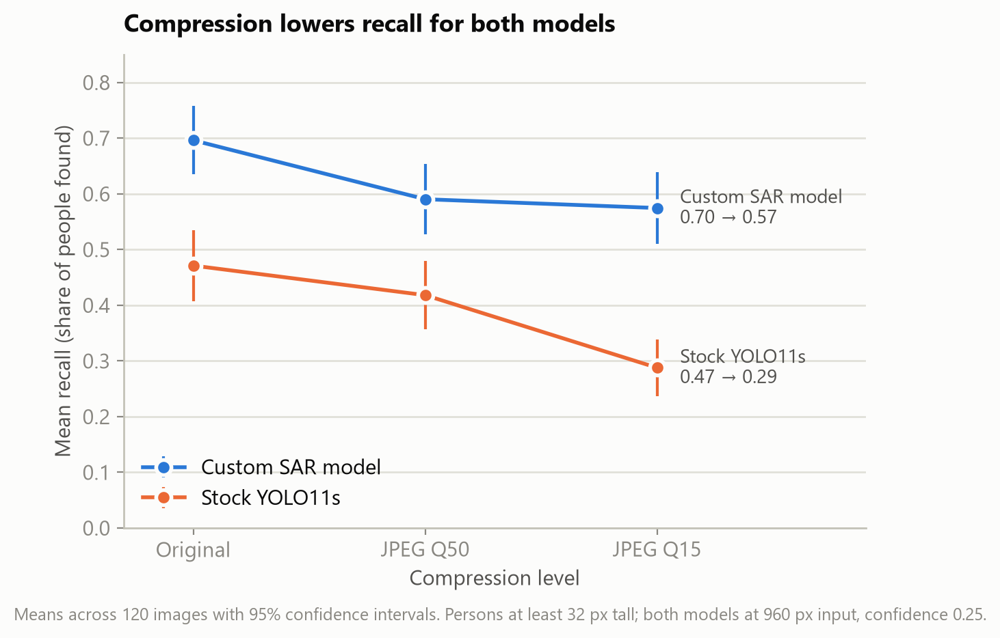

# Project-2 - Drone Video Compression and Person Detection

Does JPEG compression, like a bandwidth-limited drone video link produces, hurt a
custom search-and-rescue (SAR) person detector more than the stock YOLO11s model?



## Result in brief

On 120 VisDrone aerial images, compression lowered recall for both models. The custom SAR model fell from 0.70 to 0.57 and the stock model from 0.47 to 0.29
(original to JPEG Q15). The primary test of whether the stock model drops more was not significant (mean difference -0.06, 95% CI [-0.13, 0.004], p = .066,
dz = -0.17); the pre-planned Wilcoxon check was (p = .029), and the two-way repeated-measures ANOVA interaction was significant (p < .001). Full output is in
[`results/summary.txt`](results/summary.txt).

## Experiment design

| | |
|---|---|
| **Unit** | One image (each image sees all 6 conditions) |
| **Independent variable 1** | Compression: original (control), JPEG Q50, JPEG Q15 |
| **Independent variable 2** | Model: stock YOLO11s vs. custom SAR model, both at 960 px input, confidence 0.25 |
| **Dependent variable** | Per-image recall of persons at least 32 px tall (IoU at least 0.5); precision and F1 exploratory |
| **Sample** | 20 pilot + 120 main images, drawn at random (seed 42), at most 4 per flight sequence |
| **Primary test** | Paired t-test on D = SAR drop minus stock drop (original to Q15) |

## Repository structure

| Path | Contents |
|---|---|
| `src/download_data.py` | Downloads VisDrone2019-DET test-dev and checks its SHA256 |
| `src/sample_images.py` | Random pilot and main sample (seed 42, max 4 per sequence) |
| `src/degrade_images.py` | Makes the JPEG Q50 and Q15 copies (the manipulation) |
| `src/run_detection.py` | Runs both models on every image and quality level |
| `src/clean_data.py` | Matches detections to labels and computes per-image recall, precision, F1 |
| `src/power_analysis.py` | Sample size from the smallest effect of interest and the pilot |
| `src/analyze.py` | Primary test, checks, RM ANOVA, follow-ups, assumption checks |
| `src/make_figures.py` | All figures |
| `data/raw/` | Sample manifest, sampled original images and labels, raw detections, compression logs |
| `data/processed/` | Per-image metrics (pilot and main) |
| `results/` | Power analysis and statistical test output |
| `figures/` | Figures used in the report and presentation |

## Data

- **Source:** VisDrone2019-DET test-dev, Tianjin University
  ([VisDrone-Dataset](https://github.com/VisDrone/VisDrone-Dataset)), downloaded
  from the Ultralytics mirror. 1,610 aerial images with pedestrian and people labels.
- **Raw data in this repo:** the 140 sampled original images and their labels,
  plus every detection box from both models (`data/raw/detections_*.csv`).
- **Not in this repo:** the full dataset (301 MB; `src/download_data.py`
  re-creates it) and the compressed copies (`src/degrade_images.py` re-creates them).
- **Custom SAR model:** a fine-tuned YOLO11s for aerial person detection. Its
  weights are private and not included. Every step after detection runs from the
  committed detection files, so the statistics reproduce without them.

## Reproduction

Requires Python 3.12. From the repository root:

```bash
python -m venv .venv
.venv\Scripts\activate          # macOS/Linux: source .venv/bin/activate
pip install -r requirements.txt
```

**Re-run the statistics and figures** (no GPU or model weights needed):

```bash
python src/clean_data.py --role pilot
python src/clean_data.py --role main
python src/power_analysis.py
python src/analyze.py
python src/make_figures.py
```

**Re-run the full experiment** (needs an NVIDIA GPU and the SAR weights):

```bash
pip install torch torchvision --index-url https://download.pytorch.org/whl/cu128
pip install -r requirements-detection.txt
python src/download_data.py
python src/sample_images.py --n-main 120
python src/degrade_images.py --role pilot
python src/degrade_images.py --role main
python src/run_detection.py --role pilot --sar-weights PATH --stock-weights yolo11s.pt
python src/run_detection.py --role main --sar-weights PATH --stock-weights yolo11s.pt
```

Then run the five statistics commands above. The stock `yolo11s.pt` weights download from Ultralytics automatically. Runs used ultralytics 8.4.70 and torch
2.11.0 (CUDA 12.8) on an RTX 5090 laptop GPU.

## Design changes after the pilot

The first pilot ran each model at its deployed settings (stock at 640 px input) and counted persons at least 16 px tall. The stock model's recall was 0.06, a
floor effect that would have made any comparison meaningless. Before any main data were collected, both models were moved to the same settings (960 px,
confidence 0.25), the size rule became 32 px, and the pilot was re-sampled. The first pilot's sample is in this repository's history (pull request #2).
