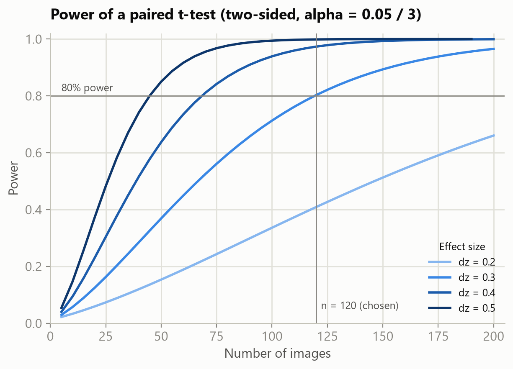
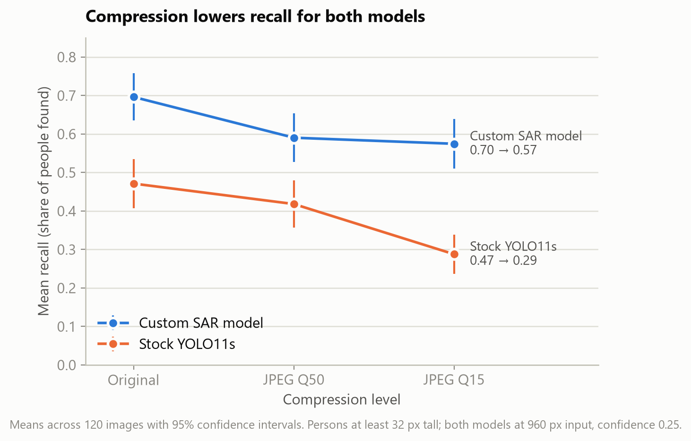
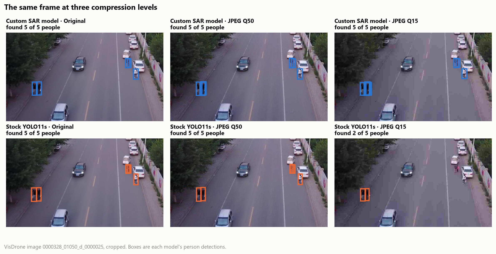

# Does Video Compression Hurt a Search-and-Rescue Detector More Than a Stock Model?

[Your name] · Sourcing Data for Analytics, Project 2 · November 2026
Repository: https://github.com/gsaju65/Project-2

## Title & Abstract

**Title:** Does Video Compression Hurt a Search-and-Rescue Detector More Than a Stock Model?

**Abstract.** Drones compress their video before sending it to the ground, so the person detector never sees the original image. I wanted to know if compression hurts my custom
search-and-rescue (SAR) model more than the stock YOLO11s model it was built from. I took 120 random aerial images from the VisDrone dataset, saved each one at three
compression levels, and ran both models on every version. Compression lowered recall (the share of people found) for both models. The SAR model went from 0.70 to 0.57, and
the stock model from 0.47 to 0.29. The stock model lost about 0.06 more, but my main test was not significant (p = .066). The SAR model found more people at every level.

## Background & Motivation

I work on a drone search-and-rescue system that runs a person detector on the live video feed. The video has to fit through a radio link, so it gets compressed before it leaves
the drone, and the weaker the link, the harder it gets compressed. The people we are looking for are often only a few dozen pixels tall, and fine detail is the first thing
compression throws away.

Past work found that image classifiers handle JPEG compression better than blur or noise (Dodge & Karam, 2016), but accuracy still drops as compression gets worse (Hendrycks &
Dietterich, 2019). Those studies used large, clear objects, not tiny people seen from the air.

I went in expecting the custom model to hold up better, since it was trained on aerial images. If it does, it is the safer choice when the link is weak. If it doesn't, the
bandwidth setting matters as much as the model.

**Who this is for:** SAR teams and drone operators who choose video and link settings, and anyone running a detector on compressed video. No statistics background is needed
to follow the results.

**Research question:** Does JPEG compression lower recall more for a custom SAR detector than for stock YOLO11s?

## Null and Alternative Hypotheses

For each image, I measured how much recall each model lost from the original to the most compressed version (Q15), then took the difference: 

> D = SAR drop − stock drop

- **H0:** The average D is 0. Compression hurts both models the same.
- **H1:** The average D is not 0. Compression hurts one model more (two-sided).

I also tested, for each model, whether recall changes across the three compression levels (H0: no change).

## Description of Experimental Design

- **Unit:** one image.
- **Independent variable 1, compression:** original (the control), JPEG quality 50 (moderate), and JPEG quality 15 (severe), all at the same resolution.
- **Independent variable 2, model:** stock YOLO11s vs. my custom YOLO11s fine-tuned for aerial person detection.
- **Dependent variable:** recall, the share of labeled people at least 32 px tall that the model found.
- **Held the same:** both models ran at 960 px input and a 0.25 confidence threshold, on the same computer.
- **Design:** every image went through all 6 combinations, so each image is compared with itself. That takes away the difference between easy and hard images.
- **Randomization:** images were picked at random with a fixed seed (42). VisDrone images come in groups from the same flight that look alike, so I kept at most 4 per flight.

## Power Analysis

I based the power analysis on a paired t-test, using `TTestPower` from statsmodels in Python. My assumptions were:

- Smallest effect worth finding: Cohen's dz = 0.3 (small to medium)
- Power: 80%
- Alpha: 0.05 for the main test, and 0.05 / 3 for the follow-up tests (Holm correction)

That called for 90 images for the main test and 120 for the follow-ups. I also ran a 20-image pilot. Its effect sizes needed fewer images (22 to 89), so I went with the larger number: **120 images**.

## Data Collection & Cleaning Procedures

**Data.** I used the VisDrone2019-DET test-dev set (Du et al., 2019; Zhu et al., 2022):
1,610 drone images with people labeled. I picked test-dev because my model's training data included other VisDrone images, and test-dev is the part least likely to have been
used. I checked the download's checksum and scanned the files before using them.

**The first pilot didn't work.** I first ran each model at its normal settings. The stock model found only 6% of the people, so it had nothing left to lose and the
comparison would have been meaningless. Before collecting any main data, I changed three things:

- both models run at the same settings,
- I only count people at least 32 px tall,
- I drew a new pilot.

The second pilot worked: both models started around 0.5 recall.

**Sample.** 420 images had at least one person 32 px or taller. After the 4-per-flight cap, I drew 20 pilot images and 120 main images. The main images covered 45 flights and 1,785 people.

**Compression.** I re-saved each image as a JPEG at quality 50 and quality 15. Quality 50 files were 20% smaller than the originals, and quality 15 files were 71% smaller.

**Scoring.**
- A detection counts as finding a person when its box overlaps the labeled box enough (IoU of at least 0.5), and each person can only be found once.
- Detections on people under 32 px, or on areas VisDrone marks as "ignore", are left out instead of being counted as mistakes.
- The script checks that all 720 results (120 images × 2 models × 3 levels) are there and that every recall is between 0 and 1.

Every step is a script in the repo, and running everything twice gave identical results.

## Statistical Analysis

**Main test: paired t-test on D.** It answers my question directly and compares each image with itself.

**Checks I planned ahead of time:**

- A Wilcoxon signed-rank test, in case D wasn't normally distributed
- A mixed model that accounts for images from the same flight
- A two-way repeated-measures ANOVA (model × compression) using all three levels
- Follow-up paired t-tests between compression levels for each model, Holm-corrected

**Assumptions.**
- **Normality:** D was not normal (Shapiro-Wilk p < .001), so the Wilcoxon test matters (Figure 5).
- **Sphericity:** violated (Mauchly p < .01), so I used the Greenhouse-Geisser correction for the ANOVA.
- **Outliers:** there were no extreme outliers.

**Mean recall (95% CI)**

| Model | Original | Q50 | Q15 |
|---|---|---|---|
| Custom SAR | 0.70 [0.63, 0.76] | 0.59 [0.53, 0.65] | 0.57 [0.51, 0.64] |
| Stock YOLO11s | 0.47 [0.41, 0.54] | 0.42 [0.36, 0.48] | 0.29 [0.24, 0.34] |

**Main test.** Average D = −0.06, 95% CI [−0.13, 0.004], t(119) = −1.86, p = .066, dz = −0.17. The stock model lost more, but not enough to reject H0 at 0.05.

**Checks**

- **Wilcoxon:** p = .029 (rank-biserial r = −0.27)
- **Mixed model:** −0.06, 95% CI [−0.14, 0.01], p = .096
- **ANOVA** (Greenhouse-Geisser corrected):
  - model: F(1, 119) = 83.7, p < .001, partial η² = .41
  - compression: F(2, 238) = 40.0, p < .001, partial η² = .25
  - interaction: F(2, 238) = 7.6, p < .001, partial η² = .06

**Follow-up tests (Holm-corrected)**

| Model | Comparison | Recall lost [95% CI] | p | dz |
|---|---|---|---|---|
| SAR | Original → Q50 | 0.11 [0.07, 0.14] | < .001 | 0.51 |
| SAR | Q50 → Q15 | 0.02 [−0.02, 0.05] | .40 | 0.08 |
| SAR | Original → Q15 | 0.12 [0.07, 0.17] | < .001 | 0.47 |
| Stock | Original → Q50 | 0.05 [0.02, 0.08] | .001 | 0.31 |
| Stock | Q50 → Q15 | 0.13 [0.08, 0.18] | < .001 | 0.45 |
| Stock | Original → Q15 | 0.18 [0.13, 0.24] | < .001 | 0.58 |

As an extra check, I also looked at F1, which balances people found against false alarms. On F1, the stock model's extra drop was significant (p < .001, dz = −0.35).

## Interpretation of Results

The first thing I checked was whether compression matters at all, and it clearly does. At Q15 the SAR model missed about 1 in 6 of the people it found in the originals, and
the stock model missed about 4 in 10.

The custom model was better at every level. It found 0.23 more of the people in the originals and 0.29 more at Q15.

The part I expected to be clear wasn't. The stock model did lose more, but my main test came in at p = .066. The Wilcoxon test, which fits this data better, and the ANOVA were
both significant, so I think the difference is real. It is small, though (dz = −0.17) and smaller than the study was designed to detect.

What surprised me was the shape. The SAR model lost most of its recall at the first step (Q50) and then barely changed. The stock model held up at Q50 and then fell off at Q15.
Figure 1 shows a typical case: at Q15 the SAR model still finds all 5 people, and the stock model finds 2.

## Limitations

- **City, not wilderness.** VisDrone is mostly streets, and real searches are mostly forests and hillsides.
- **Possible overlap.** My model was trained on some VisDrone images. Using test-dev reduces this, but I can't rule it out.
- **Only larger people.** I only scored people 32 px or taller, and real searches often involve smaller targets.
- **Same settings.** Running both models at 960 px makes the test fair, but the stock model normally runs at 640 px, where it did much worse.
- **JPEG is not video.** Drone links use video codecs like H.264, which compress across frames. My results show the direction, not exact numbers for a real link.
- **Coarse scores.** Many images had only a few people, so recall jumps in big steps (0, 0.5, 1). That's why D wasn't normal.
- **Power.** The study was built to catch dz = 0.3, and the real difference looks smaller.

## Conclusion and Recommendations

Compression costs both models a real share of the people they find. The custom SAR model finds more people at every level. There's some evidence it also holds up better, but that part isn't settled.

**Recommendations**

1. **Use the SAR-tuned model when the link forces compression.** It found more people at every level.
2. **Avoid heavy compression with a stock model.** Its biggest loss came between Q50 and Q15.
3. **Record full-quality video on the drone** so it can be reviewed after the flight.
4. **Next time:** use real H.264 video, wilderness images and smaller people, with about 275 images, enough to detect a difference this small.

## References

Dodge, S., & Karam, L. (2016). Understanding how image quality affects deep neural
networks. *Eighth International Conference on Quality of Multimedia Experience (QoMEX)*.

Du, D., Zhu, P., Wen, L., Bian, X., Ling, H., et al. (2019). VisDrone-DET2019: The vision
meets drone object detection in image challenge results. *IEEE/CVF International
Conference on Computer Vision Workshops*, 213-226.

Hendrycks, D., & Dietterich, T. (2019). Benchmarking neural network robustness to common
corruptions and perturbations. *International Conference on Learning Representations*.

Jocher, G., & Qiu, J. (2024). *Ultralytics YOLO11* (Version 11.0.0) [Computer software].
https://github.com/ultralytics/ultralytics

Zhu, P., Wen, L., Du, D., Bian, X., Fan, H., Hu, Q., & Ling, H. (2022). Detection and
tracking meet drones challenge. *IEEE Transactions on Pattern Analysis and Machine
Intelligence, 44*(11), 7380-7399.